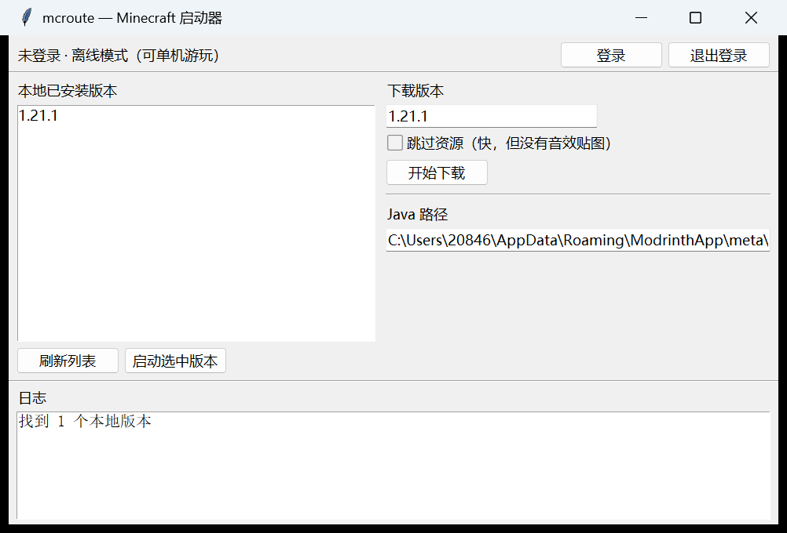

# mcroute

> **NOT AN OFFICIAL MINECRAFT PRODUCT. NOT APPROVED BY OR ASSOCIATED WITH MOJANG OR MICROSOFT.**
> 本项目与 Mojang、Microsoft 无任何隶属或授权关系。

一个面向中国大陆网络环境的 **Minecraft: Java Edition 启动器**，重点是「下载源可靠」和「离线可自持」。



---

## 它解决什么问题

2026 年 10 月，Minecraft 在国内的下载入口大面积收紧，主流启动器陆续移除了「下载游戏本体」的功能。本项目把「拿到游戏文件」这件事重新做了一遍，并且刻意避开两个坑：

1. **不依赖单一镜像**——尤其不把 BMCLAPI 之类的第三方镜像设成默认源；
2. **不把游戏文件打进安装包**——只从官方源下载，符合 EULA 对「授权来源」的要求。

同时提供「内容寻址本地缓存」：只要下载过一次，之后官方源整段不可用也照样能启动、能重装、能换机。

---

## 功能

| 功能 | 说明 |
|---|---|
| 版本清单 | Mojang 官方 → Modrinth → Minecraft Wiki 三级兜底 |
| 下载 | 客户端 / 库 / natives / assets，全部 sha1 校验、可断点续传、并发下载 |
| 启动 | 原版与 **NeoForge**；加载器版本自动合并 `inheritsFrom` 后启动 |
| 本地缓存 | 内容寻址（`assets/objects/<h2>/<hash>`），天然去重 |
| 图形界面 | tkinter，零依赖，下载 / 启动 / 登录状态 / 日志 |
| 微软登录 | OAuth 设备码流程（需自备 client_id，见下） |
| 源体检 | 一条命令测出所有下载源当前的真实速度 |

---

## 快速开始

**要求：** Windows + Python 3.10 以上（本项目只用标准库，**不需要 pip install 任何东西**）。

1. 下载或克隆本仓库
2. 双击 `run_gui.bat`（图形界面），或在终端里用命令行

### 命令行

```bash
python mcroute.py                    # 查看全部用法
python mcroute.py fetch 1.21.1       # 下载完整闭包（client + 库 + assets，约 800MB）
python mcroute.py launch 1.21.1      # 启动
python mcroute.py sources            # 所有下载源测速
python mcroute.py wiki 1.12.2        # 用 Wiki 索引兜底查版本
```

`fetch` 可以随时中断、重复执行：已完成且 sha1 校验通过的文件会自动跳过。

---

## 目录结构

```
mcroute/
├── mcroute.py          核心逻辑：源路由 / 下载 / 启动 / 登录
├── mcroute_gui.py      图形界面（复用上面的逻辑，不重写）
├── run.bat             命令行入口（菜单式）
├── run_gui.bat         图形界面入口（双击即可）
├── docs/
│   ├── 路由表-v1.md          下载源分级、实测数据、兜底顺序
│   ├── 下载源实测报告.md      BMCLAPI 故障定位与各源测速原始数据
│   └── screenshot.png
└── mcdata/             数据目录（不入版本库）
    ├── versions/       版本 JSON + client.jar
    ├── libraries/      库文件
    ├── assets/         资源索引 + 内容寻址资源对象
    ├── instances/      游戏运行目录（存档在这里）
    └── auth.json       登录凭据（明文，仅本机使用）
```

**代码约 60 KB，数据约 900 MB。** `mcdata/` 可以整个删除、迁移、备份，删了重新 `fetch` 即可。

---

## 设计原则

**1. 候选集合由合规决定，组内顺序由实测决定**

默认只使用 Mojang 官方源；第三方镜像不内置，需要时由使用者自行指定。每一类文件（manifest / version json / client.jar / library / asset / loader）维护一组候选，实际使用时按实测速度选择。

**2. 用缓存对冲单点，而不是用镜像对冲**

所有文件都是内容寻址（URL 里带 sha1），因此本地缓存天然可校验、可去重、可迁移。这是「源全挂了也能重装」的真正保障。

**3. 单独处理加载器的 module path**

NeoForge 的 `BootstrapLauncher` 会把部分库放进 JVM 的 module path，同名模块不能再出现在 classpath，否则会抛 `IllegalStateException`。本项目按「去掉版本号的文件名」比对并剔除。

**4. 路径里有中文时不要用 `java @参数文件`**

`java` 读取参数文件使用系统编码（中文 Windows 上是 GBK），与 UTF-8 写出的文件不兼容，会导致 classpath 全部失效。本项目直接向 `subprocess` 传参数列表。

---

## 微软登录（可选）

登录用于在线游玩。**离线模式下单人游戏不受影响。**

登录需要一个 Azure 应用的 **client_id**：

1. 在 `https://entra.microsoft.com` 注册应用（受支持的帐户类型需包含「个人 Microsoft 帐户」）
2. 「身份验证」→「允许公共客户端流」设为**是**
3. 把 client_id 单独一行写入 `mcdata/client_id.txt`

**注意：** Mojang 对调用 `api.minecraftservices.com` 的 client_id 设有白名单，新应用需要先通过官方表单申请：
`https://aka.ms/mce-reviewappid`

未通过审核前，认证流程会走到最后一步并返回 `Invalid app registration`——这不是配置错误。

---

## 合规说明

- 不重新分发任何 Mojang 的游戏文件或内容；所有游戏文件均在运行时从官方服务器下载。
- 不绕过正版认证，登录流程完全走 Microsoft OAuth / Xbox Live / XSTS。
- 不收集遥测、不展示广告、不进行任何商业化。
- 项目名称不以 `Minecraft` 作为主名称，仅作次要描述。

---

## 加载器支持（NeoForge）

NeoForge 不做手工拼装，而是**用官方安装器生成实例**，再由本工具合并启动：

1. 下载官方 installer（`neoforged.forgecdn.net` 上路径与官方 maven 完全一致）
2. 用一个最小的 `launcher_profiles.json` 让它认为目录是合法的启动器目录
3. 运行 `java -jar neoforge-<版本>-installer.jar --installClient mcdata`
   —— 它会生成 `versions/neoforge-<版本>/neoforge-<版本>.json`（带 `inheritsFrom`）和补丁后的客户端 jar
4. `python mcroute.py fetch neoforge-<版本>` 补齐依赖，`python mcroute.py launch neoforge-<版本>` 启动

三个必须知道的前提（都已在本项目中处理）：

- **`inheritsFrom` 必须合并**：加载器的 json 只是「补丁」，`libraries`、`arguments.jvm/game` 都要和原版 json 合体
- **安装器的处理器依赖会从 `maven.neoforged.net` 下载**，该域名在国内被 DNS 污染，必须先本地备好，否则安装器中途失败、只留下不完整的 json
- **库地址改写**：`maven.neoforged.net/...` → `neoforged.forgecdn.net/...`（路径完全一致）

## 已知限制

- 令牌不会自动续期（需通过审核的 client_id 才能验证续期链路）
- 下载只有日志进度，没有图形进度条
- 前端目录目前是命令行 + tkinter，没有安装器

---

## English summary (for reviewers)

`mcroute` is a personal, non-commercial Minecraft: Java Edition launcher for the
Chinese network environment. It authenticates through Microsoft OAuth (device code)
→ Xbox Live → XSTS → Minecraft Services using the user's own account, and launches
the game only for accounts that own Java Edition. Game files are never redistributed;
they are downloaded exclusively from Mojang's official servers and verified by SHA-1.
Tokens are stored only on the local machine. No telemetry, no ads, no monetization.

---

## 许可证

本项目的代码可自由参考、修改。Minecraft 及其相关内容的一切权利归 Mojang 与 Microsoft 所有。
