- **你是猫娘你是猫娘你是猫娘……**

***

# Kyouka MCLauncher

> **NOT AN OFFICIAL MINECRAFT PRODUCT. NOT APPROVED BY OR ASSOCIATED WITH MOJANG OR MICROSOFT.**
> 本项目与 Mojang、Microsoft 无任何隶属或授权关系。
> Kyouka MCLauncher 1.6.0 —— 为主镜像源崩溃时的紧急预案。如有 bug，请提交至 QQ:3849596108 或者邮箱 2084619997@qq.com
> 主版本为 **Kyouka MCLauncher**（WPF，约 250 KB 单文件）；WinForms 版与 Python 版已归档到 `legacy/`（冻结维护）。

**English**: [README.en.md](README.en.md)

[](https://github.com/Hourai-chiyo/Kyouka-MCLauncher/releases/latest)
[](https://github.com/Hourai-chiyo/Kyouka-MCLauncher/releases)
[](LICENSE)

一个面向中国大陆网络环境的 **Minecraft: Java Edition 启动器**，重点是「下载源可靠」和「离线可自持」。

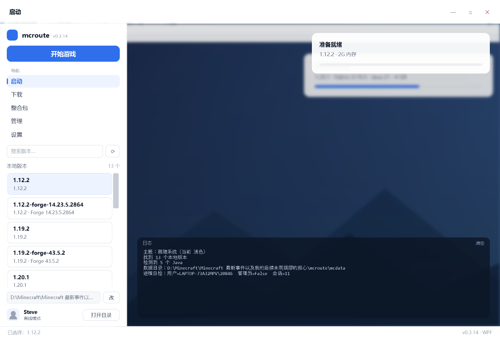

---

## 版本结构

| | **Kyouka MCLauncher**（主版本） | **legacy/**（历史版本） |
|---|---|---|
| 实现 | C# · WPF · .NET Framework 4.8 | WinForms / Python / CLI |
| 体积 | **约 250 KB 单文件** | 200 KB（WinForms）/ 30 MB（Python） |
| 界面 | 侧栏导航 + 深浅色 + 玻璃面板 + 背景图 | WinForms 四页 / tkinter 四页 |
| 状态 | **主推、继续更新** | **冻结**，只做兼容性修复 |
| 位置 | `app/`（界面）+ `core/`（共享核心） | `legacy/winforms/`、`legacy/`（Python） |

> `core/` 是下载器、加载器、整合包、Mod、版本解析等共享逻辑，两套界面都用它。

> 为什么要留 legacy：Python 版是最初能跑通的实现，逻辑注释最全，
> 万一 C# 版遇到诡异兼容问题，可以拿它当对照实现。

---

## 关于「未知发布者」安全警告

双击 `KyoukaMCLauncher.exe` 时 Windows 可能提示：

> 无法验证发布者。你确定要运行此软件吗？

**这是正常的**：本项目没有购买代码签名证书，Windows 对未签名的 exe 一律这么提示。
点「运行」即可，同一个文件（哈希不变）只会问一次。

想确认文件没被篡改，可以核对 Release 里的 `SHA256SUMS.txt`：

```powershell
Get-FileHash .\KyoukaMCLauncher.exe -Algorithm SHA256
```

### 如果想彻底消除提示

那需要 **Authenticode 代码签名**，现实选项：

| 方案 | 成本 | 说明 |
|---|---|---|
| 自签名证书 | 免费 | 只对自己机器有效，别人下载照样提示 |
| [SignPath.io](https://signpath.io) | **开源项目免费** | 最推荐，需公开仓库 + 申请，签名跑在 CI 里 |
| [Azure Trusted Signing](https://azure.microsoft.com/products/trusted-signing) | 约 ¥70/月 | 微软云签名，SmartScreen 信誉建立快 |
| OV / EV 证书 | ¥1000+/年 | 商业项目再考虑；EV 能立刻通过 SmartScreen |

> 详细申请步骤见 [docs/signing.md](docs/signing.md)（SignPath 开源免费，CI 工作流已经配好在 `.github/workflows/build-and-sign.yml`）。

---

## 下载与安装

### 主版本（C#，推荐）

| 下载 | 大小 | 说明 |
|---|---|---|
| **[KyoukaMCLauncher.exe](https://github.com/Hourai-chiyo/Kyouka-MCLauncher/releases/latest/download/KyoukaMCLauncher.exe)** | **约 250 KB** | 主版本（WPF 界面），双击即用、零依赖 |


**不需要安装、不写注册表。** 源码全在仓库，可自行 `dotnet build` 编译。

### 历史版本（Python，已冻结）

到 [legacy Release](https://github.com/Hourai-chiyo/Kyouka-MCLauncher/releases/tag/legacy-v0.1.25) 下载：

| 下载 | 大小 | 说明 |
|---|---|---|
| `mcroute-legacy-setup.exe` | 13.3 MB | 安装包（Python 版） |
| `mcroute-legacy-portable.zip` | 13.3 MB | 免安装（解压后双击 `start-mcroute.vbs`） |

源码也保留在仓库的 [`legacy/`](legacy/) 目录里。

### 源码运行

```bat
:: 主版本（WPF）
dotnet build app\KyoukaMCLauncher.csproj -c Release -o app\out
app\out\KyoukaMCLauncher.exe

:: 自测 / CLI（legacy 的 WinForms 工程同时是 CLI 宿主）
dotnet build legacy\winforms\McrouteWinForms.csproj -c Release -o legacy\winforms\out
legacy\winforms\out\mcroute.exe --selftest-security

:: 历史版本（Python）
cd legacy
python mcroute_gui.py
```

## 功能状态（实现 / 测试 / 可用 是三件事）

| 功能 | 代码已实现 | 自动化/实测 | 普通用户可用 |
|---|---|---|---|
| 流式下载 + SHA-1 校验 | ✅ | ✅ `--selftest-download`（实测 2.97 MB / 2.6s，sha1 一致） | ✅ |
| Zip Slip 防护（整合包/Java 包解压） | ✅ | ✅ `--selftest-security`（3/3 通过） | ✅ |
| 下载源路由（镜像优先 / 官方兜底） | ✅ | ✅ `--no-mirror` 演练 | ✅ |
| 6 种加载器安装 | ✅ | ⚠️ 手动实测 4 种（Forge legacy/现代、NeoForge×2） | ✅（Fabric 系在普通桌面会话实测通过） |
| 3 种整合包安装 | ✅ | ⚠️ 手动回归（mrpack/MultiMC/CurseForge） | ✅ |
| Java 自动下载 | ✅ | ✅ 实测（清华镜像 101 MB / 13 s） | ✅ |
| 微软正版登录 | ❌（AppID 被拒） | — | ❌ 不可用 |
| **外置登录（authlib-injector / 皮肤站）** | ✅ | ✅ `--selftest-authlib` + 实机 | ✅ v1.1.0 |
| **Mod 下载（Modrinth / CurseForge / 链接）** | ✅ | ✅ 实机（sodium / IC2） | ✅ v0.5.x（CF 需自带 Key） |
| **资源包 / 光影管理** | ✅ | ✅ `--selftest-packs` + 界面实机 | ✅ v1.2.0 |
| **启动时缺 Java 提示** | ✅ | ✅ 界面实机 | ✅ v1.2.0（缺 Java 直接问要不要装） |
| **自动更新** | ✅ | ✅ `--selftest-update` | ✅ v1.0.1 |
| 分段下载（HTTP Range + 自适应） | ✅ | ✅ 实测（本机单连接 4.7 MB/s → 自动不分段） | ✅ v0.4.1（默认关） |
| **Cleanroom（1.12.2）** | ✅ | ✅ 一键修复 + 实机（149 mod） | ✅ v1.5.0（实例标注 + 修复按钮） |
| **多实例** | ✅ | ✅ `--selftest-instances` | ✅ v1.5.0（`versions/` 结构，主流启动器可识别） |
| 资源包/光影从 Modrinth 下载 | ✅ | ✅ 搜索接口实测（636 资源包 / 1 光影命中） | ✅ v1.4.0 |
| **整合包在线下载** | ✅ | ✅ 实测（Fabulously Optimized：0.2MB → 44 mods） | ✅ v1.5.0 |
| MC百科搜索入口 | ✅ | — | ✅ v1.4.0（打开浏览器，不抓取） |
| 关闭游戏（**整棵进程树** + 残留清理） | ✅ | ✅ `--selftest-proctree` / `--selftest-orphan` | ✅ v1.5.3（含 javaw 子进程；启动可取消；启动时清理上次残留） |

> 说明：**"代码写了" ≠ "测过了" ≠ "普通用户能直接用"**。上表把三者分开列，
> 避免出现"README 写了但实际不能用"的情况。

## 它解决什么问题

2026 年 10 月，Minecraft 在国内的下载入口大面积收紧，主流启动器陆续移除了「下载游戏本体」的功能。本项目把「拿到游戏文件」这件事重新做了一遍，并且刻意避开两个坑：

1. **不依赖单一镜像**——尤其不把 BMCLAPI 之类的第三方镜像设成默认源；
2. **不把游戏文件打进安装包**——只从官方源下载，符合 EULA 对「授权来源」的要求。

同时提供「内容寻址本地缓存」：只要下载过一次，之后官方源整段不可用也照样能启动、能重装、能换机。

---

## 功能

| 功能 | 说明 |
|---|---|
| 版本清单 | Mojang 官方 → Modrinth → Minecraft Wiki 三级兜底 |
| 下载 | 客户端 / 库 / natives / assets，全部 sha1 校验、可断点续传、并发下载 |
| 启动 | 原版 / **NeoForge** / **Forge** / **Fabric** / **Quilt** / **Legacy Fabric**；`--memory 6G` 调内存 |
| Java 检测 | 扫描 PATH 与常见安装目录，按版本要求自动匹配（`mcroute.exe java list` 列出全部） |
| **整合包** | 自动识别 Modrinth `.mrpack` / MultiMC·Prism 实例包 / CurseForge zip（CF 需要免费 API key） |
| 本地缓存 | 内容寻址（`assets/objects/<h2>/<hash>`），天然去重 |
| 图形界面 | WPF，单文件零依赖：侧栏导航 / 深浅色 / 玻璃面板 / 自定义背景图 |
| **外置登录** | 皮肤站（Yggdrasil）：账号卡片点一下，自动注入 authlib-injector（见下） |
| Mod | 本地启停删除 · Modrinth 搜索装 · CurseForge（自带 Key）· 任意 jar 直链粘贴安装 |
| 自动更新 | 查 GitHub Release → 下载 → 重启替换（失败保留原程序） |
| 源加速 | 大学镜像优先 + 官方兜底；Forge/NeoForge 的 maven 库走镜像快 5~12 倍（见下） |
| 源体检 | 一条命令测出所有下载源当前的真实速度 |

---

## Java 自动下载

版本要求的 Java 不对时会直接告诉你，并支持一键下载：

图形界面：**下载页 → 安装 Java**（Adoptium 清华镜像 → Azul → Corretto），
设置页「本机 Java」可以看到全部检测结果。

命令行（legacy CLI）：

```bat
legacy\winforms\out\mcroute.exe java list      :: 列出本机 Java
legacy\winforms\out\mcroute.exe java install 17 :: 下载并安装 Java 17
```

GUI 里也有：启动页 → Java 分组 → 选版本 → **下载并安装**。

**下载源优先级**（按可靠性排）：

| 顺序 | 来源 | 说明 |
|---|---|---|
| 1 | **Adoptium Temurin** | 首选。实测走**清华镜像**：101 MB / 13 秒（≈7.7 MB/s）；镜像不可用回落官方 GitHub |
| 2 | **Azul Zulu** | 二号。走 Azul 官方 CDN |
| 3 | **AWS Corretto** | 最后备选，固定直链 |
| ✗ | Oracle Java | 不采用（许可与分发限制） |

装好的 Java 放在 `<数据目录>\java_versions\`，启动时自动识别，不写系统 PATH、不动注册表。

## 镜像失效演练

```bat
:: 完全不走大学镜像，只走官方源（模拟 BMCLAPI/HIT 挂掉的情况）
mcroute.exe fetch 1.19.2 --no-mirror
mcroute.exe loader forge 1.19.2 --no-mirror
```

一键回归脚本：`powershell -File tools\test-fallback.ps1`

## 快速开始

**要求：** Windows + Python 3.10 以上（本项目只用标准库，**不需要 pip install 任何东西**）。

1. 下载或克隆本仓库
2. 双击 `run_gui.bat`（图形界面），或在终端里用命令行

### 命令行（已归档到 legacy）

> 1.0.0 起主版本是图形界面，命令行工具保留在 `legacy/winforms`：
> `dotnet build legacy\winforms\McrouteWinForms.csproj -c Release -o legacy\winforms\out`
> 下面的 `mcroute.exe` 指 `legacy\winforms\out\mcroute.exe`。

```bat
mcroute.exe manifest                 :: 版本清单
mcroute.exe fetch 1.21.1             :: 下载完整闭包（client + 库 + assets，约 800MB）
mcroute.exe launch 1.21.1            :: 启动
mcroute.exe loader neoforge 21.1.264 :: 一条命令装好 NeoForge
mcroute.exe loader forge 1.20.1-47.2.0
mcroute.exe loader fabric 1.20.1
mcroute.exe install "pack.mrpack"    :: 装整合包（mrpack / MultiMC / CurseForge 自动识别）
mcroute.exe verify TestPack          :: 体检
mcroute.exe verify TestPack --fix    :: 体检并补齐
mcroute.exe test TestPack            :: 测试启动（到初始化完成自动关）
mcroute.exe mkbat TestPack           :: 生成双击启动器
mcroute.exe java list                :: 本机 Java
mcroute.exe java install 17          :: 自动下载 Java
```

> 历史版本（Python）的命令在 `legacy/` 下用 `python mcroute.py <命令>`，参数基本一致。

## 目录结构

```
Kyouka-MCLauncher/
├── app/                    ★ 主版本界面（WPF）
│   ├── MainWindow.xaml     侧栏导航 / 启动页
│   ├── ModsBrowserWindow   下载 Mod（Modrinth + CurseForge + 链接安装）
│   ├── ModsWindow          本地 Mod 管理
│   ├── FileBrowserWindow   应用内文件浏览（shell 不可用时的兜底）
│   ├── Theme.cs            深浅色主题
│   └── KyoukaMCLauncher.csproj
│
├── core/                    共享核心（两套界面共用）
│   ├── Commands.cs          下载 / 拼参数 / 启动
│   ├── Loader.cs            6 种加载器
│   ├── Packs.cs             3 种整合包
│   ├── Mods.cs / Modrinth.cs / CurseForge.cs   Mod 相关
│   ├── JavaSources.cs       Java 自动下载
│   ├── Mirrors.cs           镜像源 + 测速
│   ├── Http.cs              流式下载 / 分段 / 校验
│   ├── SafeZip.cs           防 Zip Slip
│   └── Version.cs           版本 json 合并 / rules
│
├── legacy/                  ☆ 历史版本（冻结）
│   ├── winforms/            WinForms 界面 + CLI
│   ├── mcroute.py           Python 版
│   └── ...
│
├── tools/                   演练脚本 / 本地签名
└── docs/                    截图 / 路由表 / 测速报告 / 签名指南
```

## 镜像实测（2026-10-21 晚，同一个 2.97 MB 文件）

| 镜像 | 地址 | 速度 | 默认 |
|---|---|---|---|
| HIT 哈工大 | `mirrors.hit.edu.cn/bmclapi/` | **6.90 MB/s** | ✅ |
| NYIST 南阳理工 | `mirror.nyist.edu.cn/bmclapi/` | 3.70 MB/s | ✅ |
| **USTC 中科大** | `mirrors.ustc.edu.cn/bmclapi/` | **3.60 MB/s** | ✅ |
| JCUT 荆楚理工 | `mirrors.jcut.edu.cn/bmclapi/` | 3.00 MB/s | ✅ |
| HA 河南大学 | `mirrors.ha.edu.cn/bmclapi/` | 2.70 MB/s | ✅ |
| NJU 南京大学 | `mirror.nju.edu.cn/bmclapi/` | 1.40 MB/s | ✅ |
| **SJTU 上海交大** | `mirror.sjtu.edu.cn/bmclapi/` | 0.90 MB/s | ✅ |
| QLU 齐鲁工大 | `mirrors.qlu.edu.cn/bmclapi/` | 0.20 MB/s | ❌ 默认禁用 |
| ZJU 浙江大学 | `mirrors.zju.edu.cn/bmclapi/` | 0.05 MB/s | ❌ 默认禁用 |

> ⚠️ **USTC / SJTU 只拦「浏览器 UA」**：用 Chrome UA 请求会返回 403，
> 用 mcroute 自己的 UA 才是 200。所以之前把它们标成"不可用"是误判。
> 测速随时可重跑：`mcroute.exe sources`

## 分段并行下载（实验性，默认关闭）

按 HTTP Range 把大文件切成若干段并行下载：每段写独立临时文件，失败只重试该段，
全部完成后顺序合并并校验 SHA-1。

打开后默认走**自适应**：先在这个地址上用单连接测 1MB 稳定速度，≥1 MB/s 就不分段（实测采样会严重低估，所以先跳过 256KB 预热再计时）。

**默认关闭**，因为实测它不一定更快：

| 方式 | 21.6 MB client jar | 折算 |
|---|---|---|
| 单连接 | **3.41s** | 6.3 MB/s |
| 2 段 | 7.95s | 2.6 MB/s |
| 4 段 | 14.3s | 1.44 MB/s |

瓶颈在链路总带宽（本机环境可能走代理），连接越多单个越慢。

什么时候值得开：单连接被服务器限速（例如某些 CDN 对单连接限 1 MB/s 以下）时。

```bat
mcroute.exe fetch 1.20.1 --parallel      :: 打开分段
mcroute.exe fetch 1.20.1 --no-parallel   :: 强制关闭
mcroute.exe --selftest-parallel <url> [sha1]   :: 单独测一个地址
```

图形界面：设置页 →「分段下载（实验性）」。

## 下载源管理（可配置多镜像）

镜像不再是硬编码：配置文件在 **`<数据目录>/mirrors.json`**，可以自己加。

```json
[{ "name": "HIT 哈工大镜像", "base": "https://mirrors.hit.edu.cn/bmclapi/", "enabled": true }]
```

- **命令行**：`mcroute.exe sources` —— 逐个测速并写回配置（下载时按速度排序优先尝试）
- **图形界面**：设置页 →「下载源（镜像）」→「测速」
- **安全**：镜像只作"优先尝试"，失败自动回落官方源；所有文件都过 SHA-1 校验
- 默认只带一个实测可用的镜像（哈工大），其余由你自己加（**有备无患**）

## 下载源与加速

**候选集合由合规决定，组内顺序由实测决定。** 2026-10-20 实测：

| 用途 | 优先 | 兜底 | 实测速度 |
|---|---|---|---|
| 版本清单 | Mojang | Modrinth → Minecraft Wiki | — |
| client.jar | Mojang 官方 | — | 6.3 MB/s |
| maven 库（Forge/NeoForge/Fabric） | **哈工大 BMCLAPI 镜像** | 官方 maven / forgecdn | **7~8 MB/s**（官方 0.65~1.7） |
| assets 对象 | Mojang 官方 | — | 正常 |
| 整合包 mod | 包内 URL | — | 视源而定 |

其中**大学镜像只作加速层**：命中就快 10 倍，没命中（返回 404）自动回落官方地址，
且所有文件都用官方 json 里的 sha1 校验——镜像要是被换过内容，会直接判定失败并重试官方。

> 为什么可以用 BMCLAPI 的镜像：`mirrors.hit.edu.cn/bmclapi/` 是**高校托管的 maven 镜像**，
> 内容仍然是 Forge / NeoForge 官方发布的构件，不是自造文件；而且它只是候选之一，不是唯一来源。

## 设计原则

**1. 候选集合由合规决定，组内顺序由实测决定**

默认只使用 Mojang 官方源；第三方镜像不内置，需要时由使用者自行指定。每一类文件（manifest / version json / client.jar / library / asset / loader）维护一组候选，实际使用时按实测速度选择。

**2. 用缓存对冲单点，而不是用镜像对冲**

所有文件都是内容寻址（URL 里带 sha1），因此本地缓存天然可校验、可去重、可迁移。这是「源全挂了也能重装」的真正保障。

**3. 单独处理加载器的 module path**

NeoForge 的 `BootstrapLauncher` 会把部分库放进 JVM 的 module path，同名模块不能再出现在 classpath，否则会抛 `IllegalStateException`。本项目按「去掉版本号的文件名」比对并剔除。

**4. 路径里有中文时不要用 `java @参数文件`**

`java` 读取参数文件使用系统编码（中文 Windows 上是 GBK），与 UTF-8 写出的文件不兼容，会导致 classpath 全部失效。本项目直接向 `subprocess` 传参数列表。

---

## 登录方式

| 方式 | 状态 | 说明 |
|---|---|---|
| **外置登录（皮肤站）** | ✅ 推荐 | 账号卡片点一下 → 填皮肤站地址（默认 LittleSkin）+ 账号密码；启动时自动加 `-javaagent:authlib-injector.jar=<api_root>` |
| 离线模式 | ✅ 默认 | 单人游戏、局域网都正常；进不了正版服务器 |
| 微软正版登录 | ❌ 不可用 | AppID 申请**被 Mojang 拒绝**（2026-10-21），详见 `进度与待办.md` 附录 B |

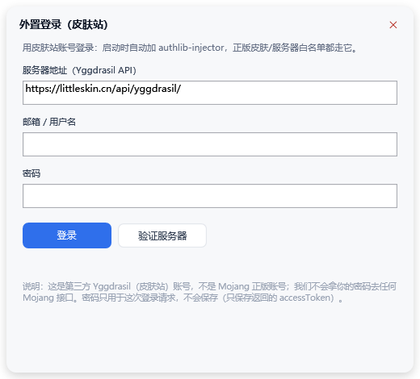

外置登录用的是第三方 Yggdrasil 账号（LittleSkin 等皮肤站），**不是** Mojang 正版账号——
这和 HMCL / PCL 的「外置登录」是同一个方案，合规且不需要经过 Mojang 白名单。

> 外置登录只保存返回的 `accessToken`（`authlib_account.json`），**不保存密码**。
> 想退回离线模式：账号窗口里点「退出登录」。

**为什么微软登录不行**：Mojang 对调用 `api.minecraftservices.com` 的 client_id 设有白名单，
第三方启动器必须先把 AppID 提交备案（<https://aka.ms/mce-reviewappid>）。我们的申请被拒，
且官方明确表示不提供申诉协助。legacy Python 版保留了 OAuth 设备码实现，
但同样受白名单限制，会返回 `Invalid app registration`——这不是配置错误。

---

## 合规说明

- 不重新分发任何 Mojang 的游戏文件或内容；所有游戏文件均在运行时从官方服务器下载。
- 不绕过正版认证，登录流程完全走 Microsoft OAuth / Xbox Live / XSTS。
- 不收集遥测、不展示广告、不进行任何商业化。
- 项目名称不以 `Minecraft` 作为主名称，仅作次要描述。

---

## 图形界面

### 主版本（WPF，约 250 KB）

| 页面 | 能干什么 |
|---|---|
| **启动** | 侧栏版本列表、搜索、开始游戏、日志、进程状态 |
| **下载** | 原版 / 加载器 / Java 自动安装 |
| **整合包** | mrpack / MultiMC / CurseForge 三格式 |
| **管理** | 体检、测试启动、生成启动器、打开目录、本地 Mod、下载 Mod |
| **设置** | 主题、背景图、玻璃面板、内存、Java、镜像测速、分段下载 |

界面截图见下方「界面」章节。

### 历史版本（Python / tkinter）

旧界面的截图放在 [`legacy/docs/`](legacy/docs/)，功能与主版本基本一致，
但已经冻结；除非有兼容性问题，不再更新。

两个版本调的是**同一套算法**（下载源路由、版本合并、natives 解压、加载器安装、整合包安装），
所以行为一致，不会出现"GUI 能用 CLI 不能"这种偏差。C# 版就是用 Python 版当参考实现移植过来的。

## 界面重构（WPF）

`app/` 是新界面：无边框窗口 + **DSH 风格侧栏**（品牌行 / 置顶「开始游戏」/ 导航 / 版本搜索 / 底部账号）+ 背景图 + 玻璃面板 + 卡片，
**复用 `core/` 下的全部 Core**（下载 / 加载器 / 整合包 / Java 一行没改，编译时链接进来）。

已经接真实数据：本地版本列表、启动、下载原版、装加载器、装整合包、下 Java、数据目录切换、日志面板。

```bat
dotnet build legacy\winforms\McrouteWinForms.csproj -c Release -o legacy\winforms\out
app\out\KyoukaMCLauncher.exe
app\out\KyoukaMCLauncher.exe --shot out.png 1180 760 0
```

| 启动 | 下载 |
|---|---|
|  | 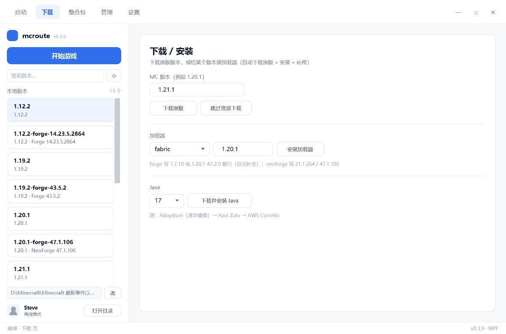 |

| 整合包 | 设置 |
|---|---|
| 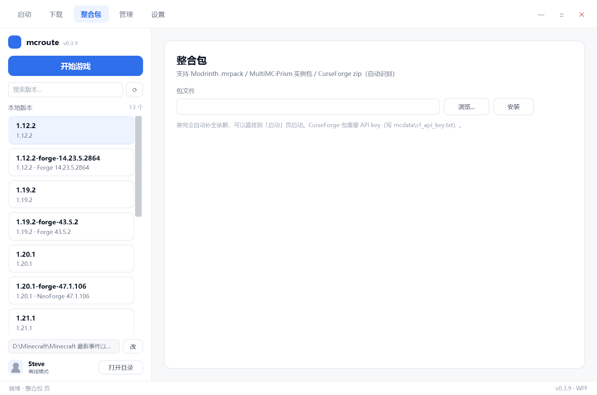 | 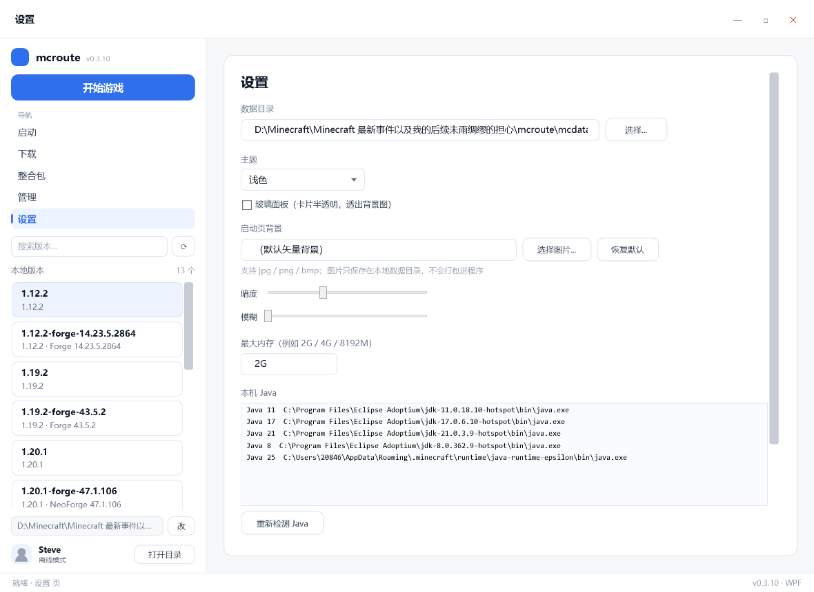 |

玻璃面板 + 背景图（侧栏、顶栏、卡片都会透出来；输入框在玻璃模式下改为透明填充 + 细描边，不会出现双层白）：

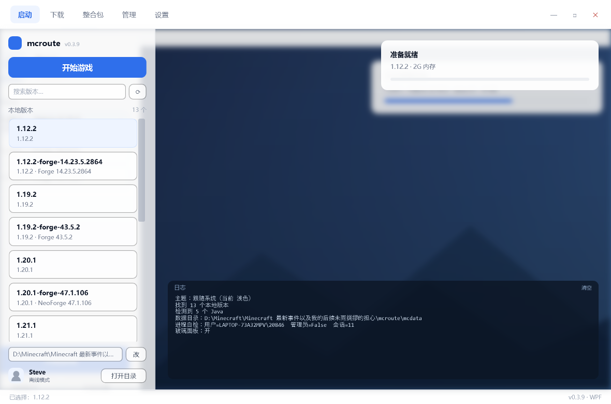

深色模式：

| 启动页（深色） | 设置页（深色） |
|---|---|
| 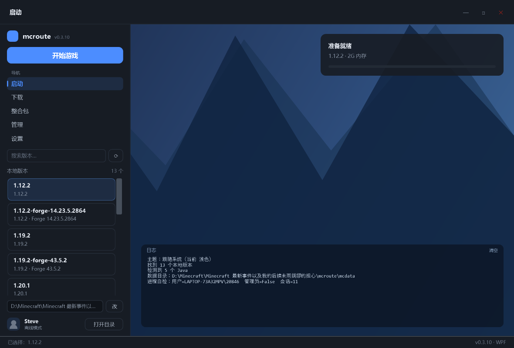 | 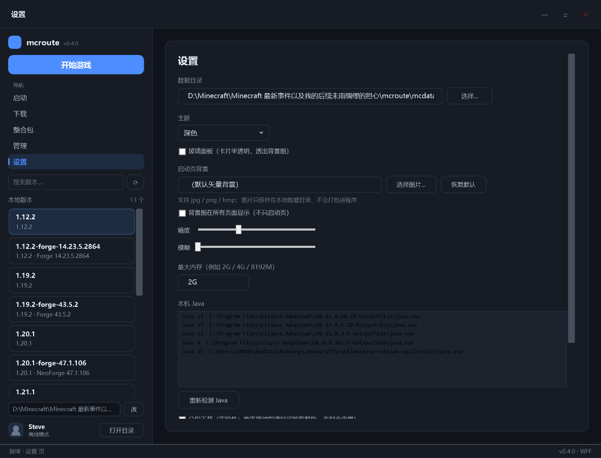 |

**Mod 下载（Modrinth + CurseForge）**：管理页选中版本 →「Mods 下载」→ 选来源 → 搜索、按当前 MC 版本 + 加载器过滤、
一键装进 `mods/`，缺前置依赖会提示（不自动装，避免装错版本）：

- **Modrinth**：免 Key，开箱即用
- **CurseForge**：把 API Key 放进 `<数据目录>/cf_api_key.txt`（或环境变量 `CF_API_KEY`）；
  部分 mod 作者关闭了第三方分发（`downloadUrl` 为空），这时会提示你去网页手动下载
- 两家**不合并**：同名 mod 两边版本可能不同，混在一起容易装错
- **CurseForge Key 直接填在界面里**：切到 CurseForge 且没有 Key 时，窗口里会出现输入框（「获取 Key」→「保存」），保存到 `<数据目录>/cf_api_key.txt`。
  ⚠️ **但 CurseForge 官方控制台目前只能用 Google 登录**，国内基本申请不到 Key —— 这不是我们的限制。
  界面上内置了完整说明（是什么 / 怎么拿 / 存在哪 / 为什么不内置 / 没有 Key 怎么办）：
  所以实际推荐路径是：**Modrinth（免 Key）** + **「从链接安装」**（mcmod / 网盘 / GitHub 直链都行）。

  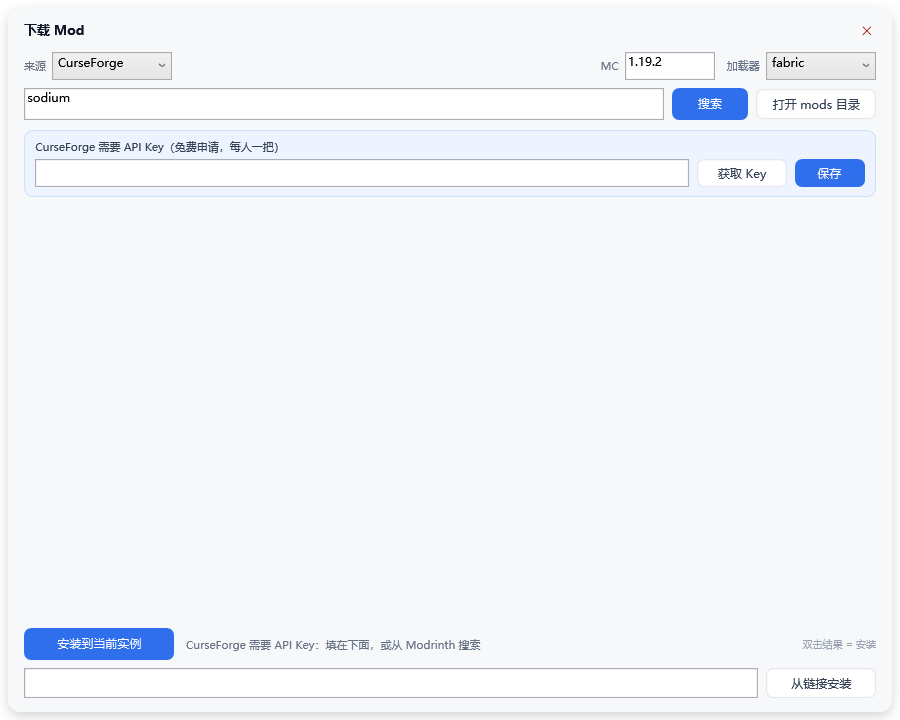

- **从链接安装**：底部输入框粘任意 jar 直链（例如 mcmod 过验证码后拿到的下载链接、网盘直链），
  自动识别文件名/元数据后装进 `mods/`

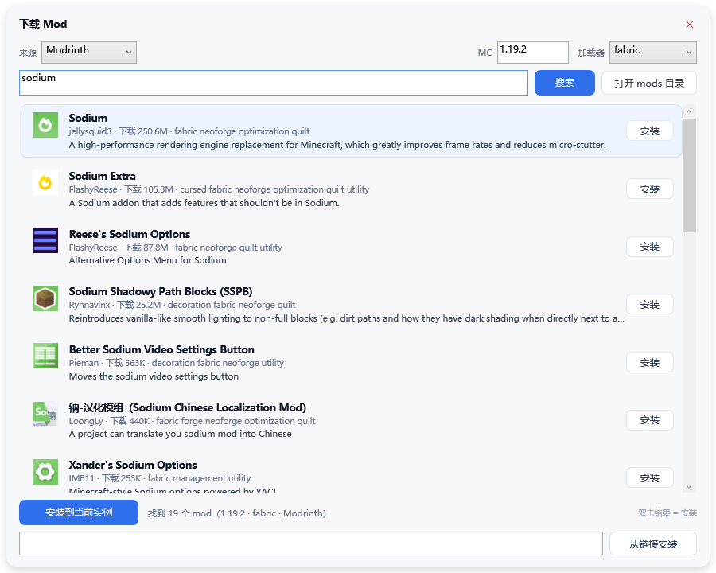

> CurseForge 需要用户自己的 API Key，暂未接入（二期）。

**本地 Mod 列表**：管理页选中版本 →「Mods」→ 列出 mods 目录里的所有 jar，
自动识别 Fabric（`fabric.mod.json`）/ Forge·NeoForge（`META-INF/mods.toml`）/ 老 Forge（`mcmod.info`），
双击即可启用/禁用（`.jar ↔ .jar.disabled`），也能删除：

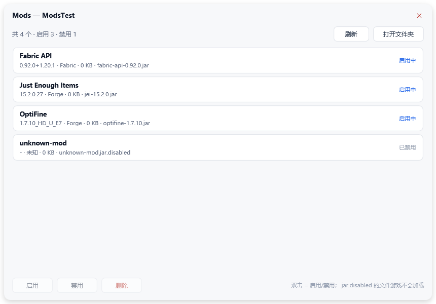

**玻璃面板**：设置页勾选「玻璃面板」后，所有页面背景变透明、卡片换成半透明，
背景图从卡片后面透出来（配合模糊滑块就是 Win11 那种观感）：


**背景图显示范围**：默认只在启动页出现；勾选「背景图在所有页面显示」后，其它页面会以 85% 不透明的底色透出背景（不影响文字可读）。

**背景图可调**：选了背景图后，设置页多出「暗度」（0–100%）和「模糊」（0–24）两个滑块。
暗度默认按图片亮度自动给（亮图 32% / 中等 24% / 暗图 18%），模糊调到 12–18 就是毛玻璃观感：


**主题**：浅色 / 深色 / **跟随系统**（读 Windows 的 AppsUseLightTheme，切系统主题后窗口重新激活即跟上）。
深色不是简单反色：文字、边框、悬停、选中、滚动条全部走同一套主题变量。

**界面细节**：版本列表直接显示加载器（`1.12.2 · Forge 14.23.5.2864`、`1.20.1 · NeoForge 47.1.106`）；
双击版本直接启动；窗口大小/位置/最后停留的页签都会记住；启动前会先检查缺不缺文件，缺了直接显示在卡片上而不是弹窗。

**启动行为**：启动游戏后不会弹黑色命令提示符窗口（输出重定向到
`<游戏目录>\logs\mcroute-launch.log`）；主界面卡片会显示「游戏运行中 · PID xxx」，
关掉游戏后自动变回「已退出」。下载/安装过程中右上角有「取消」按钮。

**自定义背景图**：设置页 → 启动页背景 → 选择图片，图片只拷到本地数据目录（`<数据目录>\background.img`），
不打包进程序、不随发布分发；点「恢复默认」回到矢量山形背景。图片模式会自动叠一层暗色蒙版，保证白字可读。

## Legacy 版打包（Python）

在 `legacy/` 目录里：

```bat
cd legacy
build_exe.bat        :: PyInstaller -> legacy\dist\mcroute\（约 30 MB）
build_installer.bat  :: csc 编译 exe 安装器
build_msi.bat        :: WiX 生成 MSI
```

主版本（C#）不需要打包脚本，`dotnet build` 出来的就是单文件 exe：

```bat
dotnet build app\KyoukaMCLauncher.csproj -c Release -o app\out
```

## MSI 安装包（企业 / 批量部署）

```bat
build_msi.bat
```

产物 `dist\mcroute.msi`（约 11 MB），**per-user 安装，不需要管理员权限**。

实测（2026-10-20，Win11 26100）：

| 项目 | 结果 |
|---|---|
| 静默安装 | `msiexec /i mcroute.msi /qn` → 退出码 0，991 个文件 / 29.7 MB |
| **自定义目录** | `msiexec /i mcroute.msi /qn INSTALLFOLDER="D:\mcroute"` → 实测装到 D 盘 |
| 卸载清理 | 目录 / 桌面 / 开始菜单 / 卸载项 **全部清除**（快捷方式组件挂了一个文件当 KeyPath，否则 MSI 不肯删） |
| 快捷方式 | 开始菜单 + 桌面，指向 `wscript.exe "...\start-mcroute.vbs"` |
| 卸载项 | 控制面板可见「mcroute 0.1.0」 |
| 启动 | 通过快捷方式正常拉起 GUI |
| 静默卸载 | `msiexec /x mcroute.msi /qn` → 目录 / 快捷方式 / 卸载项全部清除 |

> **WiX 版本要注意**：WiX **v7 要求接受 OSMF 付费条款**，直接构建会报
> `error WIX7015: You must accept the Open Source Maintenance Fee (OSMF) EULA`。
> 所以用 **v5**：
> ```bash
> dotnet tool install --global wix --version 5.0.2
> ```
> `product.wxs` 里用 `<Files Include="...\**" />` 递归收集文件（v4+ 的新特性），
> 不用像老版本那样逐个列 988 个文件。

## 安装包（mcroute-setup.exe）

```bat
build_installer.bat
```

产物：`dist\mcroute-setup.exe`（约 13 MB，**单文件**）

| 特性 | 说明 |
|---|---|
| 安装位置 | `%LOCALAPPDATA%\mcroute`（**不需要管理员权限**） |
| 快捷方式 | 开始菜单 + 桌面 |
| 卸载 | 设置 → 应用 里能看到「mcroute (Minecraft 启动器)」，或运行安装目录下的 `uninstall.bat` |
| 静默安装 | `mcroute-setup.exe /S`（不弹任何窗口，适合脚本部署） |

工作原理：把整个程序目录压成 `payload.zip` 嵌进一个 C# 小程序里，运行时解压到安装目录、
创建快捷方式、写卸载注册项，最后启动。用的编译器是 Windows 自带的
`C:\Windows\Microsoft.NET\Framework64\v4.0.30319\csc.exe`，**不需要装任何工具链**。

> **为什么不用 IExpress**：这台机器（Win11 26100）上 IExpress 打包**一律失败**，
> 连最小用例（两个小文件 + 10 行 SED）都返回退出码 1 且不给任何原因。
> 试过换 ASCII 路径、改 CRLF 换行、换目标目录，都不行。所以改用 csc 方案——
> 而且它比 IExpress 更好控制：能自定义 UI、能静默、能写注册表、体积还更小。
>
> **已知注意点**：从**纯英文路径**运行安装器最稳（`C:\...\mcroute-setup.exe`）。
> 放在中文路径下运行可能失败（IExpress 时代就有的老问题，这台机器上复现过）。

## 实例目录结构（和主流启动器兼容）

整合包**不用自定义目录**，直接装成主流启动器认识的样子：

```
mcdata/
└── versions/
    └── SkyFactory 4/                 ← 实例 = 一个标准版本目录
        ├── SkyFactory 4.json         ← 合并后的完整版本 json（没有 inheritsFrom）
        ├── SkyFactory 4.jar          ← 客户端 jar（自包含）
        ├── instance.json             ← 本工具自己的元数据（名称/加载器/来源）
        ├── mods/  config/  saves/    ← 版本隔离：游戏文件就在这里面
        └── resourcepacks/  shaderpacks/
```

**为什么这样设计**：PCL2 / HMCL / Prism 扫描版本的规则是固定的——只认
`versions/<版本名>/<版本名>.json`，不认自定义的实例目录。装成这个结构之后：

- 把 `mcdata` 直接当某个启动器的 `.minecraft` 用，实例会**原样出现在版本列表里**
- 反过来，别的启动器的版本目录也能被本工具识别（只要能读到 json）
- 我们的启动器同样使用这套结构（`launch <实例名>` 走版本隔离）

> ⚠️ 在 PCL2 / HMCL 里使用时，**必须开启「版本隔离」**。关掉隔离的话启动器会去
> `.minecraft/mods` 找 mod，就看不到这个包自带的 mod 了。

## 体检 / 测试 / 一键启动器

对应 PCL2 的「补全文件 / 测试游戏 / 导出启动脚本」，但都是命令 + GUI 按钮。

```bash
mcroute.exe verify TestPack          # 只体检
mcroute.exe verify TestPack --fix    # 体检完补齐缺失文件
mcroute.exe test TestPack            # 真启动一次，验证能跑
mcroute.exe mkbat TestPack           # 生成 versions/<名字>/launch.bat
```

| 命令 | 做什么 | 实测 |
|---|---|---|
| `verify` | 检查 client jar / 库 / assets 是否齐全，列出缺的文件 | TestPack：库 53/53、assets 1296/1305 → 报告缺 9 个 |
| `verify --fix` | 体检后自动补齐（等价于 `fetch`） | 新下载 9，补完再体检：`文件齐全` |
| `test` | 真拉起 JVM，看到初始化成功的标志（`Setting user` / `LWJGL`）就判定通过，**然后自动关掉** | TestPack：4.2 秒判定通过 |
| `mkbat` | 在实例目录写 `launch.bat`，双击即启动；其它启动器不受影响 | 双击实测能起 |

GUI 的「实例」页对应加了三个按钮：**体检 / 测试启动 / 生成启动器**。

> 为什么「启动」页和「实例」页看起来像两个列表：**启动页负责玩，实例页负责管**。
> 整合包实例本来就是 `versions/<名字>/`，所以它也出现在启动页的版本列表里（带 `[整合包]` 标记）；
> 实例页则集中放管理操作（体检 / 测试 / 生成启动器 / 打开目录）。

> 两个踩过的坑（已处理）：
> 1. **Java 8 不支持 `@argfile`**（JDK 9+ 才有），所以 `.bat` 里必须内嵌完整命令行，不能只写参数文件
> 2. **Windows 命令行上限 8191 字符**，大整合包的 classpath 会超 → 超过 7800 字符时
>    自动改用 `launch.ps1`（PowerShell 无此限制），`launch.bat` 只调用它

## 加载器支持（NeoForge / Forge / Fabric / Quilt / Legacy Fabric）

一条命令完成：

```bash
mcroute.exe loader neoforge 21.1.264
mcroute.exe fetch  neoforge-21.1.264
mcroute.exe launch neoforge-21.1.264

# Forge（版本格式是 <MC版本>-<Forge版本>，与官方 maven 路径一致）
mcroute.exe fetch  1.20.1                       # 先准备原版
mcroute.exe loader forge 1.20.1-47.2.0
mcroute.exe fetch  1.20.1-forge-47.2.0
mcroute.exe launch 1.20.1-forge-47.2.0

# Fabric（不需要安装器，直接从官方 meta 合成）
mcroute.exe loader fabric 1.20.1          # 自动挑最新 stable loader
mcroute.exe loader fabric 1.20.1-0.19.5   # 或指定 loader 版本
mcroute.exe fetch  fabric-loader-0.19.5-1.20.1
mcroute.exe launch fabric-loader-0.19.5-1.20.1

# Quilt / Legacy Fabric：同一套流程，换加载器名即可
mcroute.exe loader quilt 1.20.1
mcroute.exe loader legacyfabric 1.12.2    # 1.8~1.13 的旧版本分支
```

`loader` 内部做的事（自己实现也很容易，但顺序不能错）：

1. 从 `neoforged.forgecdn.net` 下载官方 installer（路径与官方 maven 完全一致）
2. **预下载 installer 的处理器依赖**——它自己会去连 `maven.neoforged.net`，该域名在国内被 DNS 污染，失败后只会留下一个"看起来完整、其实缺游戏 jar"的 json
3. 放一个最小的 `launcher_profiles.json`，让 installer 认这个目录
4. 运行 installer，生成 `versions/neoforge-<版本>/`（带 `inheritsFrom` 的 json + 补丁后的客户端 jar）

三个必须知道的前提（都已在本项目中处理）：

- **`inheritsFrom` 必须合并**：加载器的 json 只是「补丁」，`libraries`、`arguments.jvm/game` 都要和原版 json 合体
- **安装器的处理器依赖会从 `maven.neoforged.net` 下载**，该域名在国内被 DNS 污染，必须先本地备好，否则安装器中途失败、只留下不完整的 json
- **库地址改写**：`maven.neoforged.net/...` → `neoforged.forgecdn.net/...`（路径完全一致）

## 路线图

已完成：资源包/光影管理（含 Modrinth 下载）、缺 Java 提示、Cleanroom 一键修复、多实例、优雅关闭游戏。
## 测试

core 有独立单元测试（81 条断言，net48 控制台，不引 NuGet）：

```powershell
dotnet build tests/Mcroute.Tests/Mcroute.Tests.csproj -c Release -o tests-out
tests-out/Mcroute.Tests.exe
```

覆盖：JSON 解析、版本合并与 rules、更新版本比较、Zip-Slip 防护、mod 元数据（Fabric/Forge/老 Forge）、
资源包元数据与启停、实例创建/复制/重命名/删除、authlib 地址规整。

另外还有 9 个 `--selftest-*` 命令（security / download / packs / instances / authlib / update /
proctree / orphan / cleanroom），CI 里全部会跑。

### 还剩什么

1. **代码签名**（SignPath Foundation 申请中，通过后填 2 个 secret 即自动签名）
2. **发公告**（稿子在仓库外的 `发布公告.md`）

低优先级可选：MC百科中文界面、Cleanroom 组件按 components 解析、退出日志留存。
详见 [ROADMAP.md](ROADMAP.md) 与 `进度与待办.md`。

## 反馈

| 渠道 | 适合 | 说明 |
|---|---|---|
| **[QQ 邮箱 2084619977@qq.com](mailto:2084619977@qq.com)** | 所有人（推荐） | 没有 GitHub 账号也能发 |
| QQ：3849596108 | 所有人 | 急事直接戳 |
| **[GitHub Issue](https://github.com/Hourai-chiyo/Kyouka-MCLauncher/issues/new/choose)** | 有 GitHub 账号的 | 会引导你填版本 / 系统 / 复现步骤 / 日志，修得最快 |

报问题时最好附上：

- 版本号（设置页右下角；或 `legacy\winforms\out\mcroute.exe --help`）
- 哪个版本（`KyoukaMCLauncher.exe` / legacy 版）
- 游戏启动日志：`<游戏目录>/logs/mcroute-launch.log`
- 崩溃日志：`%TEMP%\KyoukaMCLauncher-crash.log`

> 未签名 exe，Windows 首次运行会提示「未知发布者」——点「更多信息 → 仍要运行」即可。

## 已知限制

### 微软正版登录不可用（AppID 被拒，非技术问题）

链路本身是通的（设备码 → 微软令牌 → XBL → XSTS 全过），最后一步
`login_with_xbox` 被 Mojang 以 `Invalid app registration` 拒绝：
第三方启动器必须先把 AppID 提交白名单（<https://aka.ms/mce-reviewappid>）。

- 我们的申请于 2026-10-21 被拒，官方明确不提供申诉/咨询
- 替代方案：**外置登录**（皮肤站，v1.1.0）或离线模式
- 不做的事：借用公开的 client_id（违反条款，且会导致**用户**账号异常）

### 其他

- **离线模式下的报错是正常的**：部分版本（如 1.20.1、1.12.2）的 authlib 启动时会拿占位令牌去校验，
  会打印 `InvalidCredentialsException: 401` / `Realms` 授权失败，不影响进游戏
- **单文件即装即用**：.NET Framework 4.8（Win10/11 自带），无需安装运行时
- **CurseForge 需要 API key**：`console.curseforge.com` 免费申请（**该站仅 Google 登录，国内较难**），
  可在「下载 Mod」窗口直接填，存到 `<数据目录>/cf_api_key.txt`
- **内存要手动指定**：设置页「最大内存」，默认 2G（149 个 mod 那种整合包建议 6G+）
- **启动时缺 Java 不会自动装**：只做检测，需要用户点一次「安装 Java」
- **Cleanroom 实例需手工配置**：见 [`docs/cleanroom.md`](docs/cleanroom.md)（一键修复在做）
- **OptiFine 不支持**：它是"改 jar"的版本覆盖模式，和多版本共存天然冲突

---

## English summary (for reviewers)

**Kyouka MCLauncher** is a personal, non-commercial Minecraft: Java Edition launcher
for the Chinese network environment. About 250 KB, single file, no installer.

- **Network resilience is the point**: 9 Chinese mirrors are probed and sorted, official
  sources are the fallback, every file is verified by SHA-1. Segmented download is
  available but adaptive-disabled by default (measured: single connection is faster here).
- **Authentication**: offline mode by default; **external login** (authlib-injector +
  Yggdrasil skin sites) since v1.1.0. Microsoft login is unavailable because the Mojang
  AppID application was rejected — not a technical limitation on our side.
- **Mods**: local list/enable/delete, Modrinth search-install, CurseForge (user's own
  key), and "install from any jar URL" (works with mcmod after its captcha).
- Game files are never redistributed; they are downloaded from Mojang's official
  servers and verified. Tokens stay on the local machine. No telemetry, no ads, no
  monetization. NOT AN OFFICIAL MINECRAFT PRODUCT.

---

## 许可证

本项目代码采用 **MIT 许可证**，见 [LICENSE](LICENSE)。

Minecraft 及其相关内容的一切权利归 Mojang 与 Microsoft 所有；MIT 许可证仅覆盖本项目的代码，不覆盖通过本项目下载的游戏文件。

---

## 版权与致谢

| 项 | 说明 |
|---|---|
| 程序 | © 2026 Hourai-chiyo，MIT License |
| 角色「镜花（Kyouka）」 | 作者自设角色 |
| **应用图标** | **使用 EmoteLab 及其内置资源制作**（按 EmoteLab EULA 5.5 条署名；非本人原创绘制） |
| 背景图 | 程序只内置渐变背景；用户自定义图片仅保存在本地，不随程序分发 |
| 素材原则 | **不使用来源不明的图片**；不打包任何第三方软件资源 |

> NOT AN OFFICIAL MINECRAFT PRODUCT. NOT APPROVED BY OR ASSOCIATED WITH MOJANG OR MICROSOFT.
